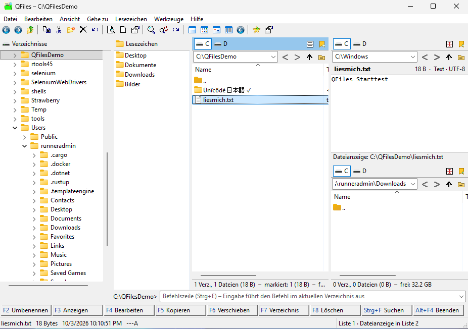

# QFiles

QFiles ist ein Dateimanager für Windows (64 Bit), nachempfunden **Idoswin Pro** (<https://www.idoswin.de/>).
Er ist in C++20 mit dem reinen Win32-API geschrieben: kein MFC, kein Qt, keine Fremdbibliotheken, eine einzige
`QFiles.exe` ohne Installation.

QFiles ist durchgehend Unicode-fähig. Dateinamen mit beliebigen Zeichen (Umlaute, Akzente, CJK, Emoji,
Surrogatpaare) werden korrekt angezeigt, umbenannt, kopiert und durchsucht. Lange Pfade über 260 Zeichen werden
ebenfalls unterstützt.



*Bildschirmfoto aus dem automatischen Starttest unter Windows Server 2025: links Verzeichnisbaum und Lesezeichen, Liste 1 mit Unicode-Verzeichnisnamen, rechts geteilte Spalte – oben die Dateianzeige der in Liste 1 gewählten Datei, unten Liste 4.*

---

## Abweichungen von Idoswin Pro

Eine nummerierte Gegenüberstellung der Funktionen von QFiles, Idoswin Pro und SpeedCommander steht in
[`QFiles Funktionsvergleich.pdf`](QFiles%20Funktionsvergleich.pdf) (erzeugt mit `tools/funktionsvergleich.py`).

| Bereich | Umsetzung in QFiles |
|---|---|
| Name, Symbol | „QFiles“ mit eigenem Programmsymbol: grüne Sammelmappe mit Lupe und Hammer auf gelbem Grund (`res/QFiles.ico`, vorgegeben; das frühere Symbol erzeugt `tools/make-icon.py`) |
| Unicode | Vollständig Unicode (UTF-16 intern), insbesondere Anzeige und Bearbeitung von Dateinamen |
| Texteditor | Neue und **leere Dateien werden standardmäßig als UTF-8 ohne BOM** gespeichert; vorhandene Dateien behalten ihre Kodierung |
| Disketten | Alle diskettenbezogenen Funktionen entfallen (keine Diskettenlaufwerke A:/B:, kein Formatieren/Kopieren von Disketten, keine Diskettengrößen beim Teilen) |
| Zwei Dateilisten | Immer **senkrecht nebeneinander**, Verzeichnisbaum links |
| Dateianzeige | Standardeinstellung „**in dem jeweils anderen Fenster**“ (Schnellansicht ersetzt die Gegenseite) |
| Kopfzeile jeder Liste | Laufwerksymbole, rechtsbündig **Lesezeichen hinzufügen** und ganz rechts **Split** |
| Pfadzeile jeder Liste | Ganz rechts ein **Kreis**: grün gefüllt = aktive Liste, hohl = nicht aktiv; ein Klick darauf macht die Liste aktiv |
| Lesezeichen | Als **senkrechte Liste zwischen Verzeichnisbaum und Dateilisten**, immer sichtbar (nicht abwählbar), statt im Kopfzeilenbereich |
| Split | Teilt eine Liste waagerecht: unten erscheint Liste 3 (links) bzw. Liste 4 (rechts) mit gleichem Kopfbereich |
| Einstellungen | Standardmäßig in `%ProgramData%\QFiles\QFiles.ini` |

### Lesezeichen-Symbol in der Kopfzeile

Ein Klick auf das Lesezeichen-Symbol (rechts in der Kopfzeile jeder Liste, links neben dem Split-Symbol, auch mit
Strg+D) fügt das in
dieser Liste gewählte Verzeichnis der Lesezeichenliste hinzu:

- Es erscheint eine Abfrage nach dem Namen. Sie ist mit dem letzten Glied des Verzeichnisnamens vorbelegt
  (bei Laufwerken z. B. `D:`).
- Steht das Verzeichnis schon in der Lesezeichenliste, zeigt die Abfrage einen Hinweis mit dem vorhandenen Namen.
- „Abbrechen“ fügt nichts hinzu.
- Das neue Lesezeichen kommt ans **Ende** der Lesezeichenliste.

### Split-Funktion

- Das **Split-Symbol** ganz rechts in der Kopfzeile (oder Strg+T) teilt die Liste. Die untere Hälfte ist ein eigenes,
  vollwertiges Listenfenster: das „dritte“ (links) bzw. „vierte“ (rechts).
- Das untere Fenster hat denselben Kopfbereich: Laufwerksymbole, rechts Lesezeichen- und Split-Symbol, darunter das
  Verzeichnis-Textfeld mit Wahlsymbolen (Zurück, Vor, Übergeordnet, Verzeichnis wählen) und dem Aktiv-Kreis.
- Im oberen Fenster wird das Split-Symbol zum **Split-aufheben-Symbol**. Im unteren Fenster erscheint es nur so.
  Ein Klick in einem der beiden hebt die Teilung auf.
- Beide Spalten lassen sich unabhängig teilen. Bis zu vier Listen sind gleichzeitig sichtbar; die Teilerhöhe ist
  mit der Maus verschiebbar.

### Dateianzeige „in dem jeweils anderen Fenster“

F11 (oder Strg+Q) schaltet die Schnellansicht ein. Die jeweils andere Liste zeigt dann den Inhalt der Datei, auf
der in der aktiven Liste der Fokus steht. Die Anzeige folgt beim Blättern und lässt sich mit Esc beenden.
Wird in der Kopfleiste der Liste mit der Dateianzeige etwas betätigt (Laufwerk, Verzeichnisfeld, Schaltflächen), endet
die Dateianzeige zuerst (wie mit F11), und diese Liste wird sofort aktiv.

| Dateityp | Darstellung |
|---|---|
| Text | Kodierung wird automatisch erkannt |
| Bilder | über WIC |
| Binärdateien | hexadezimal |
| PDF | Seitenbild (siehe unten) |
| Videos (MP4, MOV, AVI, WMV, MKV, MPEG …) | Einzelbilder (siehe unten) |
| Archive (ZIP, 7z, RAR, TAR, GZ, BZ2, XZ, CAB, ISO …) | als Liste wie ein Verzeichnis (siehe unten) |
| Office, HTML, RTF … | über die Windows-Vorschauhandler |
| Verzeichnisse | Übersicht |

Unter *Optionen → Dateianzeige* lässt sich stattdessen „in eigenem Fenster“ wählen.

**PDF** (über Windows.Data.Pdf von Windows 10/11): Eine einseitige PDF-Datei erscheint wie ein Bild. Hat sie mindestens
4 Seiten und sind die ersten 4 im Hochformat, zeigt QFiles diese 4 Seiten in 2 Zeilen zu je 2 Seiten; ebenso bei
genau 3 Hochformatseiten (das vierte Feld bleibt leer). Sonst erscheinen die ersten 2 Seiten übereinander.

**Videos** (über Media Foundation): Eine Kopfzeile nennt Auflösung und Gesamtdauer. Darunter bei Videos unter
2 Sekunden das mittlere Einzelbild; bei Querformat die Bilder nach 1 Sekunde, in der Mitte und 1 Sekunde vor Schluss
übereinander; sonst (Hochformat, quadratisch) die Bilder nach 1 Sekunde, nach einem Drittel, nach zwei Dritteln und
1 Sekunde vor Schluss in 2 Zeilen zu je 2 Bildern. Hochkant aufgenommene Handyvideos werden richtig gedreht.

Für beide gilt:

- Seiten bzw. Bilder sind durch einen 2 Pixel breiten schwarzen Strich getrennt.
- Der Aufbau läuft im Hintergrund und lässt sich mit **Esc** abbrechen. Bei PDF erscheint dann an Stelle jeder noch
  nicht gelesenen Seite zentriert „Dateiname / Seite n“ (bereits gelesene Seiten bleiben), beim Video an Stelle der
  Bilder „Dateiname / Frame-Anzeige abgebrochen“. Videos, die sich nicht lesen lassen, zeigen ebenso
  „Frame-Anzeige nicht möglich“ mit dem Grund.
- Das erzeugte Bild passt sich bei Größenänderungen der Liste an wie eine Grafik (die Datei wird nicht neu gelesen)
  und wird für den Programmlauf zwischengespeichert: Wird dieselbe, unveränderte Datei bei gleicher Größe der Liste
  erneut angezeigt, erscheint sie sofort.
- Fehlt Windows.Data.Pdf, zeigt QFiles PDFs wie bisher über den Vorschauhandler. Fehlt Media Foundation (z. B. auf
  Windows Server ohne das Feature „Media Foundation“), wird das gemeldet.

**Programmdateien** (.exe, .dll) zeigt die Dateianzeige mit sämtlichen Eigenschaften: oben das Programmsymbol (falls
die Datei eines enthält) mit Dateibeschreibung und Firma, darunter in Abschnitten die Dateiangaben, alle Einträge der
Versionsressource (Zahlen, Kennzeichen, Sprachen und alle Texte wie Firma, Copyright, Produktname), der PE-Kopf
(Format 32/64 Bit, Prozessor, Art, Subsystem, Linker- und Mindestversionen, Erstellungszeit, Sicherheitsmerkmale wie
ASLR, DEP und Control Flow Guard, .NET-Laufzeit, PDB-Datei, Abschnitte, Ressourcen, angehängte Daten), das Manifest
(Ausführungsebene, DPI, lange Pfade, unterstützte Windows-Versionen), die digitale Signatur (eingebettet oder über einen
Windows-Katalog, mit Signierer, Aussteller, Gültigkeit und Zeitstempel), die importierten DLLs mit der Zahl der
Funktionen, die exportierten Funktionen und zuletzt alle Windows-Eigenschaften, die auch der Explorer kennt. Bildlauf
mit Mausrad, Bildlaufleiste und Pfeil-/Bildtasten; **Strg+C** (oder Kontextmenü) kopiert alles als Text. Das Lesen läuft
im Hintergrund (die Signaturprüfung kann bei großen Dateien etwas dauern). Text- und Hex-Ansicht bleiben über das Menü
des Anzeigefensters wählbar.

**Archive** erscheinen als Liste wie ein Verzeichnis: blassgelb hinterlegt, solange die Archivliste aktiv ist (den
Tastaturfokus hat), sonst – bei eingeschalteter Option „Nicht aktive Listen grau hinterlegen“ – in dunklerem,
abgetöntem Gelb. Eine Infozeile nennt Archiv, aktuellen Ordner und Anzahl.

- Spalten Name, Typ, Größe, Gepackt, Geändert, Methode (soweit das Format die Angaben liefert); Sortieren per Klick
  auf den Spaltenkopf (Verzeichnisse zuerst, wie in den Listen), Spaltenbreiten veränderbar, Tippen springt zum Namen.
- Ansicht wie in den Listen über die fünf Ansichtssymbole der Werkzeugleiste bzw. Strg+Umschalt+1…5, solange die
  Archivliste aktiv ist: Details, Liste, Symbole, Miniaturansicht (sehr große Symbole – Archive enthalten keine
  Vorschaubilder) und Mit Unterverzeichnissen (alle Dateien des Ordners und seiner Unterordner mit Teilpfad).
- Ordner öffnen mit Doppelklick bzw. Eingabe, zurück mit „..“ oder Rücktaste. **Strg+F** sucht im ganzen Archiv
  (Muster mit `*`/`?`, sonst Teil des Namens); die Treffer erscheinen mit Pfad, Rücktaste oder Esc beendet die Suche.
- **Herauskopieren mit der Maus**: Dateien und Ordner in eine Liste, den Baum, auf den Desktop oder in ein anderes
  Programm ziehen (immer Kopieren). Ebenso **Strg+C** (Zwischenablage) und „Entpacken nach…“.
- Kontextmenü: **Anzeigen** (bei Dateien, die QFiles selbst anzeigen kann: Bilder, PDF, Videos, Text, Office über
  Vorschauhandler – nicht bei Archiven): eigenes Anzeigefenster in der Größe eines Listenfensters, zentriert über dem
  QFiles-Fenster; **Temporäre Kopie öffnen** (einzelne Datei; auch Doppelklick/Eingabe), Entpacken nach…, Kopieren,
  Im Archiv suchen…
- Das Archiv selbst wird nie verändert. Herausgezogene, kopierte oder geöffnete Einträge entpackt QFiles nach
  `%TEMP%\QFiles_Archiv`; Unterverzeichnisse dort, die älter als einen Tag sind, entfernt QFiles beim Start.
- Ist das Archiv kennwortgeschützt, beschädigt oder das Format unbekannt, steht statt der Liste zentriert eine
  Meldung im Klartext. Das Einlesen großer Archive lässt sich mit **Esc** abbrechen.
- ZIP liest und entpackt QFiles selbst (Verfahren „Gespeichert“ und „Deflate“); alle übrigen Formate und
  ZIP-Einträge mit anderen Verfahren laufen über das Windows-eigene `tar.exe` (ab Windows 10 1803).

---

## Funktionsumfang

### Oberfläche

- Verzeichnisbaum links. Er folgt der aktiven Liste; ein Klick öffnet das Verzeichnis in der aktiven Liste.
- Im Baum unten der aufklappbare Knoten **Netzwerk** (wie in Idoswin Pro), Netzlaufwerke mit ihrer Freigabe
  (z. B. `N:  \\fritz.box\FRITZ.NAS\media1`), Wechseldatenträger mit ihrer Bezeichnung.
- Lesezeichenliste daneben:
  - Ein Klick öffnet das Lesezeichen in der aktiven Liste, Umschalt+Eingabe in der anderen. Links neben den Namen
    steht eine schmale, hellgraue Spalte mit den Symbolen der Lesezeichen: Ein Klick auf ein Symbol öffnet das
    Lesezeichen in der anderen Liste.
  - Eigene Schrift einstellbar (*Optionen → Anzeige → Schrift der Lesezeichenliste*; „Standard“ = Oberflächenschrift).
  - Hintergrundfarben: Windows-Standardverzeichnisse (Desktop, Dokumente, Downloads, Bilder, Musik, Videos,
    Benutzerprofil, AppData, Programme, Windows usw.) **hellblau**, Cloud-Speicher (Dropbox, Google Drive,
    OneDrive) **lila**, FTP/SFTP-Zugänge **hellgrün**, WebDAV-Zugänge **noch etwas heller grün**,
    Netzwerkpfade (UNC-Pfade, Netzwerk, Rechner, Netzlaufwerke) **hellrot**.
  - **Lesezeichen → Sortieren…** (nach Rückfrage): zuerst „Netzwerk“, dann die Standardverzeichnisse, die
    Cloud-Speicher, die FTP/SFTP/WebDAV-Zugänge (gemeinsam), die übrigen Netzwerkpfade und zuletzt die lokalen
    Verzeichnisse – jeweils alphabetisch.
  - **Lesezeichen → Cloud-Speicher hinzufügen…** findet die Ordner der Desktop-Programme von Dropbox, Google Drive und
    Microsoft OneDrive (auch mehrere Konten, z. B. „OneDrive – Firma“) und legt sie als Lesezeichen an.
  - Vorgegeben ist das Lesezeichen **Netzwerk**: Es zeigt die oberste Netzwerkebene (siehe unten).
  - Sind Linux-Distributionen des Windows-Subsystems für Linux (WSL) installiert, steht direkt unter „Netzwerk“ das
    Lesezeichen **Linux** (gleiche Hintergrundfarbe, Symbol wie im Explorer). Es öffnet `\\wsl$` mit den
    Distributionen; der Tooltip nennt sie. Die Distributionen stehen in der Registrierung
    (`HKCU\Software\Microsoft\Windows\CurrentVersion\Lxss`); ohne WSL fehlt der Eintrag.
  - Ganz oben steht **Favoriten** (dunkelroter Asterisk, hellgelb), sobald mindestens eine Datei als Favorit
    gekennzeichnet ist (siehe „Favoriten“).
  - Umbenennen mit F2, Entfernen mit Entf, Verschieben mit Alt+↑/↓, Pfad über das Kontextmenü ändern.
  - Dateien lassen sich auf ein Lesezeichen ziehen.
- Eine oder zwei Dateilisten (Strg+Umschalt+L), jede teilbar (Split). Die aktive Liste ist farbig markiert. Zwischen
  linkem und rechtem Listenbereich verläuft eine dünne Trennlinie.
- Je Liste:
  - Laufwerksymbole: Ein Klick springt zum zuletzt besuchten Verzeichnis des Laufwerks; ein Rechtsklick öffnet das
    Kontextmenü des Laufwerks. Die Symbole unterscheiden lokale Laufwerke (mit dem Symbol von Windows, also z. B.
    Windows-Logo beim Systemlaufwerk und Schloss bei BitLocker), mit `subst` abgebildete Laufwerke
    (Verknüpfungspfeil), Netzlaufwerke, CD/DVD-Laufwerke, externe Laufwerke (Wechseldatenträger, USB-Sticks, externe
    Festplatten an USB, FireWire oder SD) und RAM-Disks. Der Tooltip nennt Art, Ziel (subst bzw. Freigabe) und
    Bezeichnung; der Verzeichnisbaum zeigt bei subst-Laufwerken das Ziel.
  - Verzeichnis-Textfeld mit Verlauf und Autovervollständigung; Umgebungsvariablen wie `%USERPROFILE%` sind erlaubt.
  - Zurück/Vor, Übergeordnet, **„\“** (oberste Verzeichnisebene des Laufwerks bzw. der Freigabe, Strg+Rücktaste),
    Verzeichnis wählen. Ein Rechtsklick auf Zurück bzw. Vor öffnet eine Liste der zuletzt aufgerufenen Verzeichnisse
    (neueste oben); die Zurück/Vor-Liste wird gespeichert und gilt auch nach einem Neustart (nicht im privaten Modus).
    Die Maustasten **„Zurück“ und „Vor“** einer 5-Tasten-Maus (sowie die Browser-Tasten der Tastatur) wirken wie
    „<“ bzw. „>“ der aktiven Liste.
  - Kopfzeile rechts: Lesezeichen hinzufügen, Split.
  - Statuszeile: Anzahl, Größe, Markierung, Filter, belegter und freier Speicher des Laufwerks bzw. der Freigabe.
  - Die Zeile mit den Spaltenköpfen hat die Farbe der Laufwerksleiste (aktive Liste hellblau).
- **Miniaturansicht** (Kacheln, Größe einstellbar): Sind die sichtbaren Kacheln geladen, lädt QFiles die übrigen im
  Hintergrund (zuerst die folgenden, dann die vorangehenden; neu sichtbare haben Vorrang), damit das Blättern ohne
  Wartezeit geht. Die Beschriftung zeigt immer die Endung; passt der Name nicht in zwei Zeilen, wird der Namensteil
  mit „…“ gekürzt (der vollständige Name steht im Tooltip). Videos haben eine grau hinterlegte Beschriftung.
  Miniaturen kommen von der Windows-Shell; fehlt dort eine, dekodiert QFiles Bildformate selbst über WIC (sofern der
  Codec installiert ist), und bei Handyfotos im Format HEIC/HEIF ohne HEVC-Decoder nimmt es das in den EXIF-Daten
  eingebettete Vorschaubild (falls vorhanden). Für vollständige HEIC-Bilder unter Windows: „HEIF-Bilderweiterungen“
  und „HEVC-Videoerweiterungen“ aus dem Microsoft Store.
- Ansichten: Details, Liste, Symbole, Miniaturansicht und
  **Mit Unterverzeichnissen** (Strg+Umschalt+5): wie Details, aber statt „Name“ die Spalten „Dateiname“ und
  „Unterverzeichnis“. Gezeigt werden alle Dateien des Verzeichnisses und seiner Unterverzeichnisse; „Unterverzeichnis“
  enthält den relativen Teilpfad (leer für Dateien direkt im Verzeichnis). Das Einlesen läuft im Hintergrund, die
  Einträge erscheinen nach und nach, **Esc** bricht ab. Versteckte Verzeichnisse werden nur mit „Versteckte Dateien
  anzeigen“ durchsucht, Verknüpfungspunkte (Junctions/symbolische Links) nicht. Kopieren, Verschieben, Löschen,
  Umbenennen, Anzeigen und Bearbeiten wirken auf die Dateien in ihren Unterverzeichnissen. Für lokale Verzeichnisse
  und Netzwerkfreigaben; auf FTP/SFTP/WebDAV-Servern und in der Netzwerkübersicht zeigt sie den normalen Inhalt.
  **Mittlere Maustaste** auf einer Datei in einem Unterverzeichnis: Die Liste wechselt in dieses Verzeichnis und
  markiert die Datei dort.
- **Markieren durch Ziehen** (Ansichten Liste, Details und Mit Unterverzeichnissen, wie Idoswin Pro): Beginnt das
  Ziehen mit der linken Maustaste **neben** einem Namen (rechts vom letzten angezeigten Zeichen, in einer anderen
  Spalte oder im leeren Bereich), zieht QFiles einen Auswahlrahmen auf. Markiert werden die Dateien, deren Name
  (Symbol und Text) in den Rahmen ragt – ein schmaler Rahmen rechts der Namen erfasst also nur die Dateien mit
  längeren Namen. Mit **Strg** zusätzlich zur bisherigen Markierung; am Rand wird weitergeblättert. Beginnt das Ziehen
  **auf** einem Namen (auf dem letzten angezeigten Zeichen oder links davon), gilt Drag & Drop wie gewohnt. Ein Klick
  ohne Ziehen neben einem Namen markiert die Zeile, im leeren Bereich hebt er die Markierung auf. Abschaltbar unter
  *Optionen → Bedienung*.
- Dateidatum wahlweise sekundengenau; zusätzliche Spalte „Erstellt“ (Erstellungsdatum) neben „Geändert“
  (beides unter *Optionen → Anzeige*).
- Sortieren nach Name, Typ, Größe, Datum, Erstellungsdatum oder Attributen, auf- und absteigend. Namen werden natürlich sortiert,
  wie im Explorer.
- Versteckte und Systemdateien ein-/ausblendbar. Dateifilter je Liste mit Ein- und Ausschlussmustern.
- Schriftfarben: versteckte Dateien **mittelblau**, Systemdateien **rot** (leicht abgedunkelt), versteckte
  Systemdateien **lila**. Das Grau ausgeschnittener Dateien hat Vorrang und ist leicht in Richtung dieser Farbe
  abgetönt.
- Spalte „Typ“: Endung der Datei; bei Verzeichnissen bleibt sie leer.
- Optional (*Optionen → Anzeige → „Nicht aktive Listen grau hinterlegen“*) erscheinen die nicht aktiven
  Listen mit hellgrauem Hintergrund, abgestuft von hell nach dunkel: oben (links und rechts gleich), rechts unten,
  links unten; das dunkelste Grau ist etwas heller als Kopf- und Fußleiste.
- Optional (*Optionen → Anzeige → „Listenanzeige gestreift“*) ist in der aktiven Liste jede zweite Zeile
  in diesem Hellgrau hinterlegt (Ansichten Details, Liste und Mit Unterverzeichnissen; in der Archivliste im
  abgetönten Gelb).
- Automatische Aktualisierung bei Änderungen im Dateisystem.
- Werkzeugleiste, u. a. mit Symbolen für „Neue Datei“ (Blatt mit N) und „Neue Textdatei“ (Blatt mit T), je einem
  Symbol für die fünf Ansichten (die Ansicht der aktiven Liste ist eingedrückt) und ganz rechts **P** für den
  privaten Modus. **Anpassbar** über *Ansicht → Werkzeugleiste anpassen…* oder Rechtsklick auf die Leiste: links
  die verfügbaren Schaltflächen (gut 50, z. B. auch Aktualisieren, Umbenennen, Zwischenablage, Attribute,
  Hex-Editor, ZIP, Drucken, Doppelte, Dateien vergleichen, Verzeichnisgrößen, Laufwerksübersicht,
  Eingabeaufforderung, Papierkorb, Favoriten, Dateifilter, versteckte Dateien, Teilen, Funktionstasten,
  Tastenkürzel), rechts die Leiste; Hinzufügen/Entfernen (auch Doppelklick), Trennlinien, Reihenfolge, „Standard“.
  Gespeichert in `[Werkzeugleiste] Schaltflaechen=` (leer = Standard).
- Befehlszeile: führt Befehle im aktuellen Verzeichnis in einem Konsolenfenster aus. `cd` und `X:` wechseln das
  Verzeichnis der Liste. Mit Verlauf; Dateien lassen sich hineinziehen.
- Funktionstastenleiste. Bei gedrückter Strg- bzw. Strg+Umschalt-Taste zeigt sie die Belegung der programmierbaren
  Tasten.
- Statusleiste.

### Favoriten

- Eine Datei (kein Verzeichnis, keine FTP/SFTP/WebDAV-Datei) wird über das Kontextmenü **Als Favorit kennzeichnen**
  (auch *Datei → Als Favorit kennzeichnen*, mehrere markierte Dateien auf einmal) in die Favoritenliste aufgenommen.
  Die Liste ist dauerhaft (Abschnitt `[Favoriten]` der Einstellungsdatei).
- Das Lesezeichen **Favoriten** (ganz oben, nur bei nicht leerer Liste; auch im Menü *Lesezeichen* und als Eingabe
  `Favoriten` im Verzeichnisfeld) zeigt die Favoriten in der Liste: hellgelb hinterlegt (nicht aktiv und mit der
  Option „Nicht aktive Listen grau hinterlegen“ grau), immer wie „Mit Unterverzeichnissen“, aber mit der Spalte
  **Verzeichnis** und dem vollständigen Pfad (Laufwerksbuchstabe bzw. UNC-Pfad bei Netzwerkdateien). Beim Verlassen
  gilt wieder die vorherige Ansicht.
- Dateien, die beim Aufbau der Liste nicht mehr vorhanden sind, entfallen stillschweigend aus der Favoritenliste.
  Dateien auf einem gerade nicht erreichbaren Server (oder ohne Zugriffsrecht) bleiben gespeichert und erscheinen
  wieder, sobald der Server erreichbar ist.
- In der Favoritenliste steht im Kontextmenü statt „Als Favorit kennzeichnen“ **Aus Favoriten entfernen**, dazu „Zum
  Verzeichnis der Datei wechseln“; die **mittlere Maustaste** auf einem Favoriten öffnet dessen Verzeichnis in derselben
  Liste und markiert die Datei dort. Anzeigen, Bearbeiten, Öffnen, Kopieren/Verschieben in die andere Liste,
  Umbenennen, Löschen, Attribute und Eigenschaften wirken auf die Dateien an ihrem Ort. Umbenennen und Verschieben
  mit QFiles führen die Favoriten nach. Neue Dateien/Verzeichnisse, Einfügen, Suchen, Vergleichen und
  Synchronisieren gibt es in den Favoriten nicht.

### Papierkorb

- Das Lesezeichen **Papierkorb** (hellblau wie die Windows-Standardverzeichnisse, mit dem Papierkorbsymbol – leer
  bzw. voll) zeigt den Inhalt des Papierkorbs aller Laufwerke in der Liste; ebenso *Gehe zu → Spezielle
  Verzeichnisse → Papierkorb* und die Eingabe `Papierkorb` im Verzeichnisfeld. Bestehende Einstellungen erhalten das
  Lesezeichen einmalig hinter den Standardverzeichnissen; wer es entfernt, bekommt es nicht wieder.
- Spalten: **Name** (ursprünglicher Name), **Ursprünglicher Ort**, Typ, Größe, Geändert und **Gelöscht am**;
  sortierbar wie gewohnt, Tippen springt zum Namen. Die Ansicht entspricht „Mit Unterverzeichnissen“; beim
  Verlassen gilt wieder die vorherige Ansicht.
- Kontextmenü: **Wiederherstellen** (an den ursprünglichen Ort; fehlende Verzeichnisse werden angelegt),
  **Wiederherstellen in die andere Liste** (Umschalt+F6, unter dem ursprünglichen Namen), **Kopieren in die andere
  Liste** (Umschalt+F5, das Element bleibt im Papierkorb), **Anzeigen** (F11), **Endgültig löschen** (Entf, mit
  Rückfrage), **Papierkorb leeren…** (auch *Werkzeuge → Papierkorb leeren…*).
- Technik: Die Liste liefert die Shell (wie im Explorer); die Angaben je Element liest QFiles aus der
  „$I…“-Datei neben dem Inhalt („$R…“) im Ordner `\$Recycle.Bin\<SID>` des Laufwerks. Wiederherstellen und
  endgültiges Löschen erledigt QFiles selbst (Verschieben des $R-Elements, Löschen der $I-Datei).
- **Löschen rückgängig:** Was QFiles in den Papierkorb gelöscht hat, stellt *Bearbeiten → Rückgängig* (Strg+Z)
  wieder her.
- Bearbeiten, Umbenennen, Attribute, Ausschneiden/Kopieren über die Zwischenablage, neue Dateien und Vergleichen gibt
  es im Papierkorb nicht; Dateien gelangen nur über „Löschen“ hinein.

### Privater Modus und Verlauf

- **Privater Modus**: Schaltfläche **P** am Ende der Werkzeugleiste (abgerundetes Viereck; grün gefüllt =
  eingeschaltet), *Werkzeuge → Privater Modus* oder *Optionen → Bedienung*. Im privaten Modus sind die Kopfzeilen
  der aktiven Liste und ihre Spaltenköpfe **grün** statt blau.
- Beim Einschalten wird der aktuelle Verlauf festgehalten (Zurück/Vor-Listen, Verzeichnisverlauf und letztes
  Verzeichnis der Listen, Befehlszeile; Suchmuster und Umbenennungsmasken werden nicht mehr gespeichert). Bis zum
  Ausschalten wird nur dieser Stand gespeichert, auch beim Beenden. Beim Ausschalten gilt wieder der festgehaltene
  Verlauf.
- **Werkzeuge → Verlauf löschen…** löscht nach Rückfrage die Zurück/Vor-Listen, den Verzeichnisverlauf, die letzten
  Verzeichnisse je Laufwerk, den Befehlszeilenverlauf sowie die zuletzt verwendeten Suchmuster und
  Umbenennungsmasken (auch den im privaten Modus festgehaltenen Stand).

### Dateioperationen

- Kopieren (Umschalt+F5) und Verschieben (Umschalt+F6) in die andere Liste.
- Umbenennen mit F2: immer der vollständige Umbenennungsdialog (auch für eine einzelne Datei). Direkt in der Liste
  umbenennen: langsamer zweiter Klick auf den Namen.
- Neues Verzeichnis (F8), neue leere Datei (F9), neue Textdatei mit Editor (Umschalt+F9; vorgeschlagen wird „Neue Textdatei.txt“, markiert ist nur der Name ohne „.txt“).
- **Duplizieren** (F10): Namensvorschlag „Name - Kopie.ext“; der Knopf „Nummeriert“ setzt „Name (1).ext“ ein bzw.
  zählt hoch, wenn es den Namen schon gibt oder er bereits auf „(n)“ endet.
- Löschen in den Papierkorb (Entf) oder endgültig (Umschalt+Entf). In der Werkzeugleiste stehen dafür drei Symbole:
  Papierkorb (Löschen in den Papierkorb), Kreuz (endgültig löschen), Radiergummi (Radieren).
- **Radieren** (Alt+Entf): Der Inhalt wird mit kryptografisch zufälligen Daten überschrieben – „Ja (1×)“ einmal,
  „2ד bis „5ד in der Rückfrage entsprechend oft, jeweils mit neuen Zufallsdaten –, die Datei auf Länge 0
  gekürzt, in einen Zufallsnamen umbenannt und gelöscht; Verzeichnisse rekursiv. Nicht rückgängig zu machen.
  Hinweis: Auf SSDs und bei Schattenkopien/Cloud-Synchronisierung kann der alte Inhalt physisch erhalten bleiben.
- Ausführung über die Windows-Shell (`IFileOperation`): Fortschrittsanzeige, Konfliktdialoge, Rechteerhöhung.
- Wird eine **einzelne Datei** in ein anderes Verzeichnis kopiert oder verschoben, in dem es den Namen schon gibt,
  bietet QFiles **Mit neuem Namen ablegen** an (vorbelegt „Name (1).ext“, bei Bedarf hochgezählt), außerdem
  „Ersetzen“ und „Abbrechen“.
- **Rückgängig** (Strg+Z) für Kopieren, Verschieben, Umbenennen, Anlegen und Löschen in den Papierkorb.
- Drag & Drop zwischen Listen, Baum, Lesezeichen und anderen Programmen. Ziehen in ein Listenfenster **verschiebt**;
  mit gedrückter **Umschalt- oder Strg-Taste** wird kopiert. Ist das Ziel ein FTP/SFTP/WebDAV-Verzeichnis, wird erst
  nachgefragt (OK = verschieben, **Kopieren** = nur hochladen, Abbrechen). Auf Baum und Lesezeichen gilt die
  Explorer-Regel (gleiches Laufwerk verschieben, sonst kopieren). Die rechte Maustaste fragt nach Kopieren oder
  Verschieben. Ziel in einer Liste: In den Ansichten Details und „Mit Unterverzeichnissen“ legt das Loslassen in einer
  anderen Spalte als „Name“ immer im Verzeichnis der Liste ab. In der Spalte „Name“ (auch in der Ansicht Liste) einer
  Verzeichniszeile gilt: auf dem Namen selbst (Symbol und Text, beim Ziehen hervorgehoben) ins Unterverzeichnis; im
  Leerraum hinter dem Namen fragt QFiles, ob das Listenverzeichnis oder das Unterverzeichnis gemeint ist (mit Abbruch) –
  auch wenn die Dateien schon im Listenverzeichnis liegen.
- Zwischenablage: Ausschneiden, Kopieren, Einfügen, kompatibel mit dem Explorer. Ausgeschnittene Dateien erscheinen
  in mittelgrauer Schrift (und mit blassem Symbol), solange „Einfügen“ sie verschieben würde – also bis sie eingefügt
  sind oder etwas anderes in die Zwischenablage kommt (auch aus dem Explorer).
- Explorer-Kontextmenü, „Öffnen mit“, Eigenschaften (Alt+Eingabe).
- **Mit anderer Liste vergleichen** (Kontextmenü einer einzelnen Datei): erscheint, wenn Beyond Compare installiert
  ist und eine andere sichtbare Liste eine gleichnamige Datei enthält. Beyond Compare zeigt dann beide Dateien
  (die Datei der weiter links bzw. oben stehenden Liste links). Das Symbol, ein schwarzer Kreis, ist zur Hälfte
  (Liste daneben bzw. darüber/darunter) oder zu einem Viertel (Liste schräg gegenüber) grau gefüllt – auf der Seite, in
  der die andere Liste liegt. Kommt die Datei in mehreren Listen vor, gibt es je Liste einen Eintrag (mit Richtung im
  Text). Beyond Compare 3–5 wird über die Registrierung (Scooter Software, App Paths) und die Programmverzeichnisse
  gefunden; die Umgebungsvariable `QFILES_BCOMPARE` kann einen anderen Pfad vorgeben.
- Attribute und Zeitstempel ändern, auch rekursiv. Das Datum lässt sich aus dem EXIF-Aufnahmedatum übernehmen.
- Verzeichnisgrößen berechnen (Leertaste auf einem Verzeichnis oder Alt+Umschalt+Eingabe für alle). Mit der Option
  **„Verzeichnisgrößen anzeigen“** (*Optionen → Anzeige* oder *Ansicht*) berechnen die Listen die Größen aller
  Unterverzeichnisse automatisch im Hintergrund, sobald ein Verzeichnis angezeigt wird (nicht auf FTP/SFTP/WebDAV und
  in der Netzwerkübersicht); beim Aktualisieren bleiben berechnete Größen erhalten.

### Netzwerk

- Netzwerkpfade (`\\Server\Freigabe\…`) funktionieren überall wie lokale Verzeichnisse.
- **Netzwerk** (Baumknoten, Lesezeichen oder Eingabe `Netzwerk` bzw. `\\` im Verzeichnisfeld) zeigt die gefundenen
  Rechner: Rechner verbundener Netzlaufwerke, die klassische Netzwerkumgebung und die Netzwerkerkennung von Windows.
  Ein Rechner (`\\Server`) zeigt seine Freigaben, eine Freigabe ihren Inhalt; „..“ führt wieder nach oben.
- Die Suche läuft im Hintergrund, die Einträge erscheinen nach und nach. **Esc** bricht sie ab; angezeigt bleiben
  die bis dahin gefundenen Einträge. F5 sucht erneut.

### FTP, SFTP und WebDAV

- **Lesezeichen → Neuer FTP/sFTP/WebDAV-Zugriff…** legt einen Zugang als Lesezeichen an: Protokoll (SFTP, FTP,
  WebDAV über HTTPS oder WebDAV über HTTP),
  Server, Port, Benutzer, Kennwort, Startverzeichnis (leer = Anmeldeverzeichnis des Servers) und für SFTP optional
  eine Schlüsseldatei. „Verbindung testen“ prüft die Angaben. Bearbeiten über das Kontextmenü der Lesezeichenliste
  („Pfad ändern…“).
- Adressen: `sftp://benutzer@server[:port]/pfad`, `ftp://benutzer@server[:port]/pfad`,
  `davs://benutzer@server[:port]/pfad` (WebDAV über HTTPS) bzw. `dav://…` (über HTTP) – auch direkt im
  Verzeichnisfeld; `https://…` und `http://…` werden als WebDAV-Adresse übernommen. FTP ohne Benutzer meldet sich
  anonym an.
- WebDAV (z. B. Nextcloud/ownCloud: Startverzeichnis `/remote.php/dav/files/benutzer`, Synology, QNAP, IIS, Apache):
  über die Windows-HTTP-Schnittstelle (WinHTTP) mit Proxy-Einstellungen und Zertifikatsprüfung von Windows;
  Anmeldung per Basic, Digest, NTLM oder Kerberos (Negotiate). Der Zeitstempel hochgeladener Dateien wird vom Server
  gesetzt (WebDAV kennt kein Setzen des Änderungsdatums).
- In der Liste: Verzeichnisse öffnen, Kopieren und Verschieben in die andere Liste (hoch- und herunterladen, auch
  zwischen zwei Servern, Verzeichnisse mit Inhalt, Zeitstempel bleiben erhalten), Löschen, Umbenennen (F2), neues
  Verzeichnis (F8), neue Datei (F9), Anzeigen (F11, auch in der Dateianzeige im anderen Fenster), Bearbeiten (F4) und
  Öffnen: Die Datei wird in ein temporäres Verzeichnis geladen; nach dem Speichern lädt QFiles sie automatisch wieder
  hoch.
- **Eigenschaften** (Kontextmenü, Alt+Eingabe; auch Attribute): Name, Ort, Größe, Datum, Besitzer/Gruppe und die
  **Unix-Zugriffsrechte** als Kästchen (Lesen/Schreiben/Ausführen für Besitzer, Gruppe, Andere) und als Oktalzahl
  (z. B. 644); bei mehreren Elementen werden unterschiedliche Rechte gemeldet, OK setzt den Wert für alle. SFTP setzt
  die Rechte über SFTP-setstat, FTP über `SITE CHMOD` (vom Server abhängig; WebDAV kennt keine Unix-Rechte). Die
  Statuszeile zeigt die Rechte des Fokuselements (z. B. `rw-r--r-- (644)  besitzer:gruppe`).
  Bedeutung: jede Ziffer ist die Summe aus 4 = lesen, 2 = schreiben, 1 = ausführen, für Besitzer, Gruppe und alle
  anderen. 600 = nur der Besitzer, 640 = zusätzlich die Gruppe lesend, **644 = alle dürfen lesen** – nötig z. B. für
  Dateien einer Website, damit der Webserver (der unter einem anderen Benutzer läuft) sie ausliefern kann;
  755 für Verzeichnisse und Skripte.
- Ist ein FTP/SFTP-Verzeichnis gewählt, entfällt in der Kopfzeile der Liste das Lesezeichensymbol (Zugänge entstehen
  über den Menüpunkt; Strg+D öffnet den Zugangsdialog mit dem aktuellen Verzeichnis).
- Kennwörter werden nur gespeichert, wenn gewünscht – verschlüsselt mit der Windows-Datenschutz-API (DPAPI), nur für
  den angemeldeten Windows-Benutzer lesbar. Sonst fragt QFiles einmal je Sitzung.
- SFTP: Beim ersten Verbinden wird der Fingerabdruck des Hostschlüssels angezeigt und nach Bestätigung in
  `%ProgramData%\QFiles\QFiles-Hostschluessel.txt` gespeichert; ein geänderter Schlüssel wird deutlich gemeldet.
  Anmeldung mit Schlüsseldatei, SSH-Agent (Windows-OpenSSH-Agent, Pageant), Kennwort oder keyboard-interactive.
- FTP und WebDAV über HTTP übertragen Kennwort und Daten unverschlüsselt (Hinweis in der Statuszeile);
  FTP-Dateinamen in UTF-8.

### Cloud-Speicher

Dropbox, Google Drive und OneDrive werden über die Ordner ihrer Windows-Programme eingebunden (Dropbox-Ordner,
Google-Drive-Laufwerk mit „Meine Ablage“, OneDrive-Ordner); die Synchronisierung übernimmt das jeweilige Programm.
Ein direkter Zugriff über die Web-Schnittstellen der Anbieter würde je Anbieter eine dort registrierte Anwendung mit
Browser-Anmeldung erfordern und ist nicht eingebaut.

### Werkzeuge

| Werkzeug | Funktion |
|---|---|
| Dateigruppe umbenennen (Strg+M) | Masken mit Platzhaltern (siehe unten), Zähler, Suchen/Ersetzen (auch regulärer Ausdruck), Groß-/Kleinschreibung, Unterverzeichnisse, Live-Vorschau mit Konfliktprüfung; ein Rückgängig-Schritt; die umbenannten Dateien bleiben in der Liste markiert |
| Dateien suchen (F3) | Name, Text in UTF-8/UTF-16/ANSI sowie in Office-Dokumenten (.docx, .xlsx, .pptx, OpenDocument .odt/.ods/.odp, EPUB) und **PDF** (Text der Seiten, Formulare/Kommentare und Dokumenteigenschaften; auch mit leerem Benutzerkennwort verschlüsselte PDFs – RC4, AES-128, AES-256; gescannte Seiten ohne Textebene enthalten keinen Text), Größe, Datum, Attribute; Ergebnisliste mit „Gehe zu“; **Schließen und markieren** markiert die gefundenen Dateien in der aktiven Liste, **Schließen und invers markieren** alle übrigen Dateien (die Liste wechselt dazu ggf. ins durchsuchte Verzeichnis und, wenn Treffer in Unterverzeichnissen liegen bzw. invers mit Unterverzeichnissen gesucht wurde, in die Ansicht „Mit Unterverzeichnissen“); Fenstergröße, -position und Spaltenbreiten bleiben erhalten |
| Doppelte Dateien | Gleicher Inhalt: Größe, dann Hash, dann byteweiser Vergleich |
| Dateien vergleichen (Strg+K) | Text zeilenweise nebeneinander mit Farbmarkierung und zeichengenauer Hervorhebung; Binärvergleich |
| Verzeichnisse vergleichen (F7) | Vergleicht die aktive Liste mit einer anderen (bei Split mit Auswahlfrage, z. B. links oben mit links unten oder rechts oben); hinterlegt unterschiedliche (gelb), neuere (grün), ältere (lachsfarben) und fehlende (blau) Dateien farbig, gleiche bleiben ohne Farbe; markiert je nach Auswahl neuere und fehlende, unterschiedliche oder gleiche Dateien. Die Farben verschwinden mit „Markierung aufheben“ (Num /) oder „Vergleichsmarkierungen entfernen“ |
| Verzeichnisse synchronisieren (Strg+Umschalt+Y) | In eine oder beide Richtungen, mit Vorschau, Filter, Spiegeln |
| Datei teilen / zusammenfügen | Mit CRC-Prüfsumme und Batchdatei zum Zusammenfügen ohne QFiles |
| Archive | ZIP anzeigen, entpacken und erstellen (Windows-Shell); 7z, RAR, TAR, CAB, ISO u. a. anzeigen und entpacken über das Windows-eigene `tar.exe`; Archivliste in der Dateianzeige (F11, siehe oben) |
| Laufwerksübersicht | Belegung aller Laufwerke |
| Dateisystemmonitor | Protokoll aller von QFiles ausgeführten Dateioperationen |
| Verzeichnisliste | Drucken, als Textdatei speichern oder in die Zwischenablage, wahlweise mit Unterverzeichnissen |
| Spezielle Verzeichnisse | Desktop, Dokumente, Downloads, AppData, Startmenü u. a. |

### Programmierbare Funktionstasten

QFiles hat 24 programmierbare Funktionstasten: **Strg+F1 … F12** und **Strg+Umschalt+F1 … F12**. Belegt werden sie
unter *Werkzeuge → Funktionstasten belegen*. Eine Taste kann ein Programm, ein Dokument, eine URL oder einen
Konsolenbefehl starten.

Platzhalter in Parametern und Arbeitsverzeichnis:

| Platzhalter | Bedeutung |
|---|---|
| `%P` | aktuelles Verzeichnis |
| `%O` | Verzeichnis der Gegenseite |
| `%F` | Fokusdatei mit Pfad |
| `%N` | Name der Fokusdatei |
| `%E` | Name ohne Erweiterung |
| `%S` | markierte Dateien mit Pfad |
| `%M` | markierte Namen |
| `%L` | Listendatei (UTF-8) |
| `%%` | Prozentzeichen |

### Integrierter Texteditor (F4)

- RichEdit im Klartextmodus, beliebig viele Fenster.
- Kodierungen: UTF-8 (Standard für neue und leere Dateien, ohne BOM), UTF-8 mit BOM, UTF-16 LE/BE, ANSI, OEM.
- Zeilenenden CRLF, LF und CR; beim Speichern wählbar.
- Suchen, Ersetzen, Gehe zu Zeile.
- **Zeilen sortieren** (auf-/absteigend, ohne Groß-/Kleinschreibung, natürlich), doppelte Zeilen entfernen,
  Groß-/Kleinschreibung umwandeln, Tabulatoren und Leerzeichen umwandeln.
- Drucken.
- Meldet, wenn die Datei außerhalb des Editors geändert wurde.

### Anzeige und Hex-Editor

- Anzeigefenster (Umschalt+F11) für Text, Bilder (Zoom), Hex und Vorschauhandler; blättert durch die Dateien des
  Verzeichnisses.
- Hex-Editor (Alt+F11) für beliebig große Dateien. Er arbeitet im Überschreibmodus, hebt Änderungen hervor, hat
  Rückgängig und kann suchen (Hex/Text) sowie zu einem Offset springen.

### Platzhalter beim Umbenennen von Dateigruppen

| Platzhalter | Bedeutung |
|---|---|
| `[N]` | Name ohne Erweiterung |
| `[N3]` | 3. Zeichen |
| `[N2-5]` | Zeichen 2 bis 5 |
| `[N2-]` | ab dem 2. Zeichen |
| `[N-3]` | die letzten 3 Zeichen |
| `[N2,4]` | 4 Zeichen ab dem 2. |
| `[E]` | Erweiterung (Bereiche wie bei `[N]`) |
| `[C]` | Zähler (Start, Schritt, Stellen einstellbar) |
| `[D]` | Änderungsdatum JJJJMMTT |
| `[d]` | Änderungsdatum JJJJ-MM-TT |
| `[T]` | Uhrzeit hhmmss |
| `[t]` | Uhrzeit hh-mm-ss |
| `[P]` | Name des Elternverzeichnisses |
| `[[`, `]]` | eckige Klammern |

---

## Tastenkürzel (Auswahl)

Funktionstasten (auch in der Fußzeile anklickbar):

| Taste | Funktion |
|---|---|
| F2 | Umbenennen (Dialog; mehrere Dateien: Dateigruppe umbenennen) |
| F3 | Suchen |
| F4 | Bearbeiten |
| F5 | Aktualisieren (Verzeichnisse neu einlesen, auch bei abgeschalteter automatischer Aktualisierung) |
| F6 | Markierung umkehren |
| F7 | Vergleich (Verzeichnisse) |
| F8 | Neues Verzeichnis |
| F9 | Neue Datei (Umschalt+F9: neue Textdatei) |
| F10 | Duplizieren |
| F11 | Anzeigen |

Weitere:

| Taste | Funktion |
|---|---|
| Eingabe / Rücktaste | Öffnen / übergeordnetes Verzeichnis |
| Tab, Strg+1…4 | Nächste Liste, Liste 1…4 |
| Umschalt+F5 · Umschalt+F6 | Kopieren · Verschieben in die andere Liste |
| Entf · Umschalt+Entf · Alt+Entf | Löschen (Papierkorb) · endgültig löschen · Radieren |
| Umschalt+F11 · Alt+F11 | Anzeigefenster · Hex-Editor |
| Strg+T | Split / Split aufheben |
| Strg+Umschalt+1…5 | Ansicht: Details · Liste · Symbole · Miniaturen · Mit Unterverzeichnissen |
| Strg+Q | Dateianzeige im anderen Fenster |
| Strg+D | Gewähltes Verzeichnis den Lesezeichen hinzufügen |
| Strg+Z | Rückgängig |
| Strg+K · Strg+Umschalt+Y | Dateien vergleichen · Synchronisieren |
| Strg+L / Strg+G · Strg+E | Verzeichnis eingeben · Befehlszeile |
| Alt+F1 · Alt+F2 | Verzeichnisbaum · Lesezeichenliste |
| Leertaste / Einfg · Num+ / Num− / Num* | Markieren · Gruppe markieren / abwählen / umkehren |
| Umschalt+F10 | Kontextmenü |
| F1 | Übersicht aller Tastenkürzel (auch „Tastenkürzel“ in der Menüleiste): je Kürzel eine Zeile; ein Klick auf die Zeile schließt die Übersicht und löst die Taste aus |

---

## Einstellungen

Gespeichert werden:

- alle Optionen,
- Fensterposition und -größe,
- Breiten von Baum und Lesezeichenliste,
- Teilungsverhältnisse und Split-Zustand,
- die zuletzt in den **vier Listenfenstern** angezeigten Verzeichnisse mit Ansicht, Sortierung, Spaltenbreiten,
  Filter, Verzeichnisverlauf und Zurück/Vor-Liste (im privaten Modus der Stand beim Einschalten),
- die Lesezeichen und die Favoriten,
- die Funktionstasten,
- der Befehlszeilen-Verlauf,
- Größe, Position und Spaltenbreiten des Suchfensters.

Fenster- und Listenzustand (Größe, Position, Ansicht, Spaltenbreiten, Teilungen) werden nicht erst beim Beenden,
sondern jeweils kurz nach einer Änderung gespeichert; sie bleiben also auch erhalten, wenn QFiles nicht regulär
beendet wird (z. B. beim Herunterfahren oder nach einem Absturz). Ausschalten lässt sich das zusammen mit
„Einstellungen beim Beenden speichern“.

Speicherort:

1. **Standard:** `%ProgramData%\QFiles\QFiles.ini` (z. B. `C:\ProgramData\QFiles\QFiles.ini`), Textdatei in UTF-8.
2. Portabel: Liegt eine `QFiles.ini` neben der `QFiles.exe`, wird diese verwendet.
3. Befehlszeile: `QFiles.exe /ini="D:\Pfad\eigene.ini"`.

Weitere Befehlszeilenargumente: `QFiles.exe [Verzeichnis Liste 1] [Verzeichnis Liste 2]`.

**Exportieren / Importieren** (*Optionen*, Knöpfe unten links): Der Export schreibt alle Optionen, die
Lesezeichen und die FTP/SFTP/WebDAV-Zugangsdaten **ohne Kennwörter** in eine INI-Datei (UTF-8). Beim Import werden die
Optionen übernommen; für die Lesezeichen fragt QFiles, ob sie die bisherigen **ersetzen** (Ja), **ergänzen** (Nein,
vorhandene Pfade werden übersprungen) oder nicht übernommen werden sollen (Abbrechen). Kennwörter sind mit der
Windows-Datenschutz-API an den Windows-Benutzer gebunden und lassen sich ohnehin nicht übertragen; QFiles fragt sie
beim ersten Verbinden ab.

---

## Bauen

Voraussetzung: CMake ≥ 3.20 und Visual Studio 2022 (MSVC, x64) oder MinGW-w64 (gcc ≥ 13).

```bat
cmake -S . -B build -G "Visual Studio 17 2022" -A x64
cmake --build build --config Release
build\Release\QFilesTests.exe
```

Cross-Build unter Linux mit MinGW-w64:

```sh
cmake -S . -B build -DCMAKE_TOOLCHAIN_FILE=cmake/mingw-w64-x86_64.cmake -DCMAKE_BUILD_TYPE=Release
cmake --build build
```

GitHub Actions (`.github/workflows/build.yml`) baut bei jedem Push mit MSVC und MinGW. Auf Windows laufen dabei die
automatischen Tests (Kodierungen, Einstellungsdatei, Dateioperationen mit Unicode-Namen und langen Pfaden,
Netzwerk-, FTP- und WebDAV-Adressen, FTP und WebDAV (Basic und Digest) gegen lokale Testserver, SFTP/FTP lesend gegen
den öffentlichen Testserver test.rebex.net) und ein Oberflächentest mit Bildschirmfotos (u. a. Freigaben von
`\\localhost`, eine FTP-Liste und die Ansicht „Mit Unterverzeichnissen“). Wird auf GitHub ein Release veröffentlicht, hängt der Workflow `QFiles.exe` und `QFiles-x64.zip` an.

### Aufbau des Quelltexts

| Datei | Inhalt |
|---|---|
| `src/main.cpp`, `MainWindow.*` | Hauptfenster, Layout, Menüs, Befehle, Tastenkürzel, Befehlszeile, Funktionstastenleiste |
| `src/FilePane.*` | Listenfenster mit Kopfzeile (Laufwerke, Split, Lesezeichen), Pfadzeile, virtueller ListView, Schnellansicht |
| `src/DirTree.*`, `BookmarkList.*` | Verzeichnisbaum, Lesezeichenliste |
| `src/FileOps.*`, `ShellMenu.*` | Dateioperationen mit Rückgängig, Zwischenablage, Kontextmenü, Drag & Drop |
| `src/Location.*`, `Network.*` | Netzwerk-, FTP- und WebDAV-Adressen, Suche nach Rechnern und Freigaben |
| `src/Remote.*`, `RemoteFs.h`, `FtpClient.cpp`, `SftpClient.cpp`, `WebDavClient.cpp`, `RemoteCommon.cpp` | FTP/SFTP/WebDAV: Zugänge, Verbindungen, Übertragungen |
| `src/Cloud.*` | Erkennen der Cloud-Speicher-Ordner (Dropbox, Google Drive, OneDrive) |
| `src/Viewer.cpp`, `MediaPreview.*`, `HexView.*` | Anzeige (Text, Bild, Hex, Vorschauhandler, PDF-Seiten, Video-Einzelbilder), Hex-Editor |
| `src/ProgramInfo.*` | Eigenschaften von Programmdateien (Versionsressource, PE-Kopf, Signatur, Shell-Eigenschaften) |
| `src/DocText.*`, `PdfText.*` | Text aus Office-Dokumenten und PDF für die Suche (eigenes Deflate, PDF-Objekte, Schriftkodierungen, Entschlüsselung) |
| `src/Thumbnail.*` | Miniaturen der Kachelansicht (Shell, WIC, EXIF-Vorschaubild aus HEIC/HEIF) |
| `src/RecycleBin.*` | Papierkorb-Ansicht: Auflisten, Wiederherstellen, endgültig löschen, leeren |
| `src/ArchiveView.cpp`, `ArchiveCore.h` | Archivliste der Dateianzeige (Lesen und Entpacken in `Archive.cpp`) |
| `src/Drives.*` | Laufwerksarten und -symbole (lokal, subst, Netzwerk, CD/DVD, extern, RAM-Disk) |
| `third_party/libssh2` | libssh2 1.11.1 (BSD-Lizenz) für SFTP, gebaut mit der Windows-Kryptografie |
| `src/Settings.*`, `App.*` | Einstellungsdatei, Optionen, globale Dienste, Dateisystemmonitor |
| `src/Util.*`, `Encoding.*`, `Dialog.*`, `Glyphs.*` | Hilfsfunktionen, Textkodierungen, Dialoge ohne Ressourcendatei, Symbole |
| `src/TextEditor.*` | Texteditor |
| `src/Compare*.cpp`, `SyncDirs.cpp` | Datei- und Verzeichnisvergleich, Synchronisieren |
| `src/BatchRename.cpp`, `FindFiles.cpp`, `Duplicates.cpp`, `SplitJoin.cpp` | Umbenennen, Suchen, Doppelte, Teilen |
| `src/Tools.cpp`, `Attributes.cpp`, `FunctionKeys.cpp`, `Archive.cpp`, `PrintList.cpp`, `OptionsDialog.cpp` | Weitere Werkzeuge und Optionen |

---

## Absturzberichte

Stürzt QFiles ab, wird neben der Einstellungsdatei ein Bericht mit Aufrufstapel gespeichert
(`%ProgramData%\QFiles\QFiles-Absturz.txt`, dazu ein Minidump `QFiles-Absturz.dmp`). Wirft beim Kontextmenü eine
Shell-Erweiterung eines anderen Programms eine unbehandelte Ausnahme, wird das abgefangen: QFiles läuft weiter und
meldet Aufruf, betroffenen Menüeintrag, Ausnahmecode, bei C++-Ausnahmen Typ und Text sowie die Module auf dem
Aufrufstapel mit der vermutlich verursachenden DLL. Die vollständigen Angaben werden an
`%ProgramData%\QFiles\QFiles-Kontextmenue.txt` angehängt.

### Kontextmenü-Erweiterungen ausschließen

Unter *Optionen → Programme* („Kontextmenü-Erweiterungen nicht laden“, in der INI-Datei
`[Optionen] KontextmenueAusschluss=`) stehen Muster, durch `;` getrennt. Kontextmenü- und Drag-&-Drop-Erweiterungen,
deren Name, Beschreibung oder DLL-Pfad (in Langform, ohne Groß-/Kleinschreibung) eines der Muster enthält, lädt
QFiles nicht; ihre Einträge fehlen im Kontextmenü von QFiles. Dazu registriert QFiles nur innerhalb des eigenen
Prozesses eine leere Ersatz-Erweiterung für deren Klassen-IDs – die Registrierung und der Explorer bleiben
unverändert. Voreinstellung ist `ArchiCrypt` (die RAM-Disk-Erweiterung `URDShellExt.dll` von ArchiCrypt Ultimate
RAM-Disk wirft beim Zeichnen ihres Eintrags „RAM-Disk erstellen“ Ausnahmen). Verursacht eine ausgeschlossene
Erweiterung dennoch einen Fehler, wird er nur protokolliert, ohne Meldung, und ihr Eintrag für den Rest der Sitzung
ausgeblendet. Ein leeres Feld schaltet den Ausschluss ab.

Damit schon der erste Kontextmenü-Aufruf schnell ist, lädt QFiles kurz nach dem Start im Hintergrund (niedrige
Priorität) die DLLs der für Dateien, Ordner und Laufwerke registrierten Kontextmenü-Erweiterungen – ohne die
ausgeschlossenen und ohne Erweiterungscode außer der DLL-Initialisierung auszuführen – und legt das
Standard-Kontextmenü der Shell einmal an.

## Bekannte Einschränkungen

- Der Hex-Editor arbeitet nur im Überschreibmodus (kein Einfügen/Löschen von Bytes).
- ACE-Archive werden nicht unterstützt. RAR, 7z und andere Formate lassen sich nur anzeigen und entpacken, und nur
  soweit `tar.exe` (ab Windows 10 1803) sie kennt. Dabei können Namen außerhalb der Systemcodepage in der
  Listenansicht verfälscht werden; „Alles entpacken“ ist davon nicht betroffen.
- FTP: nur passiver Modus, kein verschlüsseltes FTPS (dafür SFTP verwenden). SFTP-Server, die ausschließlich
  Ed25519-Hostschlüssel anbieten, werden nicht unterstützt (RSA- und ECDSA-Schlüssel, wie bei OpenSSH üblich, schon).
- Für FTP/SFTP/WebDAV-Verzeichnisse stehen nicht alle Werkzeuge zur Verfügung (z. B. Vergleichen, Synchronisieren,
  Suchen, Ziehen aus der Liste heraus, Rückgängig); QFiles meldet das. Dateien lassen sich aber auf eine
  FTP/SFTP/WebDAV-Liste ziehen (hochladen).
- WebDAV: Umbenennen und Verschieben auf dem Server über MOVE; Server, die Ordner nicht per PROPFIND auflisten
  (reine HTTP-Downloadseiten), werden nicht unterstützt.
- Cloud-Speicher nur über die installierten Desktop-Programme der Anbieter (siehe oben). Bei „Dateien bei Bedarf“
  (OneDrive, Dropbox, Google Drive) lädt Windows eine nur online vorhandene Datei beim Öffnen oder Kopieren herunter.
- Die Ansicht „Mit Unterverzeichnissen“ liest auf Wunsch ganze Laufwerke; das kann bei sehr vielen Dateien dauern
  und Speicher belegen (Esc bricht ab).
- Welche Rechner unter „Netzwerk“ erscheinen, hängt von der Netzwerkerkennung von Windows ab.
- Die Oberfläche ist deutsch; eine Sprachumschaltung gibt es nicht.
